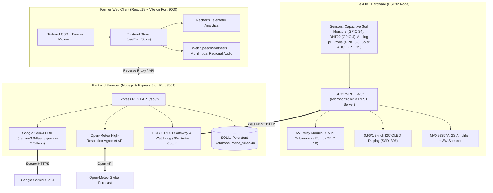

# Raitha Vikas AI — Smart Farming for a Better Tomorrow
### *ಕೃತಕ ಬುದ್ಧಿಮತ್ತೆ ಆಧಾರಿತ ಸ್ಮಾರ್ಟ್ ಕೃಷಿ ಸಹಾಯಕ (AgTech IoT & Multimodal AI Platform)*

**Raitha Vikas AI** is an end-to-end, production-ready Smart Agricultural Assistant and IoT Telemetry Platform designed for Indian farmers and school science exhibitions. It combines real-time IoT soil sensor telemetry, automated smart irrigation with safety hysteresis, Google Gemini AI multimodal leaf pathology diagnostics, real-time Open-Meteo weather intelligence, APMC Mandi market prices, multilingual voice announcements (Kannada, Hindi, English), and persistent SQLite local storage.

---

## 🏗️ Architecture & Technology Stack



---

## 🌟 Key Features & Functional Modules

### 1. 🌾 Farmer At-a-Glance Dashboard
Answers the three critical daily farming questions in under 3 seconds:
- **How is my soil?** Real-time Volumetric Soil Moisture (%) and calibrated Soil pH (6.5 Slightly Acidic) with crop suitability notes.
- **Does my crop need water?** Clear "Yes / No" irrigation advice incorporating soil moisture thresholds and rain forecasts.
- **What should I do today?** Priority farming action checklist (e.g., bio-fertilizer schedule, Mandi price surge alert, rainfall preparation).

### 2. 🤖 Context-Aware AI Farming Assistant (Google Gemini)
- **Natural Language Chat**: Communicates in simple English, ಕನ್ನಡ (Kannada), and हिंदी (Hindi).
- **Live Telemetry Injection**: Automatically reads current soil moisture, pH, temperature, and pump status into the prompt context.
- **Agromet Wisdom**: Provides practical ICAR-aligned advice, organic remedies (Jeevamrutha, Neem cake), and Gram Panchayat Krishi Vigyan Kendra (KVK) referrals for severe issues.
- **Zero Hallucination Policy**: If sensors are offline or unconfigured, the AI explicitly states telemetry is unavailable rather than fabricating readings.

### 3. 🔬 Multimodal Crop Leaf Disease Diagnosis
- **Real Image Upload**: Accepts JPEG, PNG, and WebP photos (up to 5MB) via drag-and-drop or camera capture.
- **Gemini Vision Pathology**: Identifies crop, disease candidate, scientific name, severity level, symptoms, organic remedies, chemical treatments with dosages, and prevention protocols.
- **Strict Structured JSON**: Backend parses and validates the diagnosis before saving it into persistent SQLite history.

### 4. 💧 Smart Automated Irrigation with Safety Watchdog
- **Hysteresis Band**: Configurable trigger threshold (default 35%) and cutoff threshold (default 70%) to avoid rapid pump relay oscillation.
- **30-Minute Safety Watchdog**: Prevents overwatering, motor burnout, or field flooding if a sensor becomes disconnected or fails.
- **Relay Driver Requirements**: Explicit support for optocoupler-isolated relays with flyback diode protection.

### 5. 🧪 Calibrated Soil pH Sensor & History
- Displays real-time pH on the standard 0–14 scale with status classification (Strongly Acidic to Alkaline).
- Crop suitability matrix for Tomato, Paddy, Maize, Cotton, Chili, and Sugarcane.
- Scientific disclaimer: App explicitly informs farmers that pH alone does not dictate fertilizer needs without N-P-K nutrient soil testing.

### 6. 🌦️ Live Open-Meteo Weather & Rain Postponement Advisory
- Real hourly and 5-day daily forecast using high-resolution ECMWF / GFS meteorological models.
- Location presets for Karnataka agricultural districts: Mandya, Bengaluru, Mysuru, Kolar, Belagavi, Hubballi, and custom GPS coordinates.
- **Automated Rain Advisory**: Postpones irrigation pump recommendation when rain probability exceeds 60%.

### 7. 🏪 Mandi Market Prices (APMC Karnataka)
- Live modal rates for Paddy (Mandya), Tomato (Kolar), Maize (Davanagere), and Cotton (Raichur).
- Price change trends, arrival volumes, and daily trading date.

### 8. 🗣️ Multilingual Voice Announcements
- Text-to-speech audio broadcaster in English, Kannada, and Hindi.
- Configurable speech rate, pitch, and one-tap test broadcasts.

---

## 🔒 Security & API Key Management

The Google Gemini API key is strictly kept on the server:
- **Never committed to Git**: `.env` is listed in `.gitignore`.
- **Never sent to frontend**: Client bundles contain zero API keys. Client requests go to `/api/*` endpoints.
- **Masked in Health Endpoints**: `/api/health` returns only masked hints (e.g. `AQ....wKA`).
- **Configurable Model**: Configurable through `GEMINI_MODEL=gemini-3.8-flash` without silent switching to paid models.

---

## ⚡ Quick Start & Local Run Guide

### Prerequisites
- Node.js v18+ (tested on Node v20 & v26)
- npm or yarn

### 1. Installation
```bash
# Clone the repository
git clone <repository-url>
cd "Raitha Vikas AI"

# Install dependencies
npm install
```

### 2. Environment Configuration
Copy `.env.example` to `.env`:
```bash
cp .env.example .env
```
Open `.env` in any text editor and paste your Google Gemini API key:
```env
GEMINI_API_KEY=your_actual_gemini_api_key_here
GEMINI_MODEL=gemini-3.8-flash
PORT=3001
NODE_ENV=development
ESP32_BASE_URL=
```
*(If you need a free key, get one in 30 seconds at [Google AI Studio](https://aistudio.google.com/)).*

### 3. Run Development Servers
To run both the Express backend (port 3001) and Vite frontend (port 3000) concurrently:
```bash
npm run dev
```

Or run them individually in separate terminals:
```bash
# Terminal 1: Backend Express Server
npm run dev:server

# Terminal 2: Frontend Vite Client
npm run dev:client
```
Open your browser to: **`http://localhost:3000`**

---

## 🚀 Production Build & Deployment

### Local Production Test
```bash
# Compile TypeScript and bundle frontend with Vite
npm run build

# Start the unified production server (serves API and dist/ static assets on port 3001)
npm start
```
Visit **`http://localhost:3001`**

### Deploying to Cloud (Render / Railway / VPS)

#### Option A: Render (Recommended Web Service)
1. Push repository to GitHub.
2. In Render Dashboard, click **New Web Service** and select your repository.
3. Configure:
   - **Environment**: `Node`
   - **Build Command**: `npm install && npm run build`
   - **Start Command**: `npm start`
4. Add Environment Variables:
   - `GEMINI_API_KEY`: *(Your Google AI Studio key)*
   - `GEMINI_MODEL`: `gemini-3.8-flash`
   - `NODE_ENV`: `production`
5. Click **Deploy**.

#### Option B: Railway
1. Click **New Project** &rarr; **Deploy from GitHub Repo**.
2. Set Environment Variables under the **Variables** tab.
3. Railway automatically detects `npm run build` and `npm start`.

---

## 🔌 ESP32 Hardware Integration & Pinout Guide

The ESP32 Arduino firmware is located in: [`firmware/esp32_raitha_vikas.ino`](file:///c:/Users/maksedul%20mandal/OneDrive/Desktop/Raitha%20Vikas%20AI/firmware/esp32_raitha_vikas.ino).

### Pin Wiring Diagram

| Component | Pin on Module | ESP32 GPIO Pin | Power Supply | Notes |
| :--- | :--- | :--- | :--- | :--- |
| **Capacitive Soil Sensor** | Analog AOUT | **GPIO 34** (ADC1) | 3.3V | Calibrate dry (3200) vs water (1400) |
| **Soil pH Sensor Probe** | Analog Po | **GPIO 32** (ADC1) | 5.0V | Calibrate with pH 4.0 & 7.0 buffer |
| **DHT22 Climate Sensor** | Data Pin | **GPIO 4** (Pull-up) | 3.3V / 5V | 10kΩ pull-up resistor to VCC |
| **5V Relay Module** | IN / Signal | **GPIO 16** | 5.0V | Active LOW relay recommended |
| **Solar Voltage Divider** | Analog Out | **GPIO 35** (ADC1) | 3.3V Max ADC | 100kΩ / 20kΩ divider from 12V solar |
| **OLED Display (SSD1306)**| SDA / SCL | **GPIO 21 / 22** | 3.3V | I2C address `0x3C` |
| **MAX98357A I2S Audio** | BCLK / LRC / DIN | **GPIO 26, 25, 22** | 5.0V | Connected to 3W 4Ω speaker |

### ⚠️ Hardware Safety Warning
- **Relay Flyback Protection**: Inductive loads (water pumps) produce voltage spikes when powered off. Always use a relay board with an optocoupler and flyback diode to prevent ESP32 brownouts and resets.
- **Power Isolation**: Never power a 12V or 240V submersible pump directly from the ESP32 board's 3.3V pin. Use an external 12V 2A power adapter or 18650 battery pack with common ground.
- **Watchdog Timer**: The firmware contains an internal 30-minute auto-cutoff watchdog. If communication with the server drops during pumping, the ESP32 will automatically turn off the relay after 30 minutes.

---

## 📡 REST API Reference

| Endpoint | Method | Description |
| :--- | :--- | :--- |
| `/api/health` | `GET` | Returns server status, Gemini model, masked API key, and environment. |
| `/api/ai/chat` | `POST` | Context-aware AI farming assistant. Accepts `prompt`, `language`, and `farmContext`. |
| `/api/ai/disease-detect` | `POST` | Multimodal leaf disease analysis. Accepts `multipart/form-data` with `leafImage` and `cropType`. |
| `/api/ai/disease-analyses` | `GET` | Retrieves recent leaf diagnostic history from SQLite. |
| `/api/weather` | `GET` | Real Open-Meteo forecast and agromet advisory. Accepts `location`, `lat`, `lon`. |
| `/api/esp32/status` | `GET` | Checks ESP32 WiFi connectivity and device health. |
| `/api/esp32/sensors` | `GET` | Fetches live analog sensor values from connected ESP32. |
| `/api/esp32/pump` | `POST` | Commands the ESP32 relay ON/OFF with watchdog timeout. |
| `/api/irrigation/settings`| `GET/POST` | Reads or updates moisture threshold low/high hysteresis settings. |

---

## 🏆 Science Exhibition Demonstration Script

For judges and attendees at the science fair:
1. **Explain the Problem**: Indian farmers lose crops due to over-irrigation, unseasonal rains, and misdiagnosed leaf diseases.
2. **Show the 3 Questions**: Point to the "Farmer At-a-Glance" cards on the dashboard ("How is my soil?", "Does my crop need water?", "What to do today?").
3. **Demonstrate Soil Monitoring**: Submerge the capacitive probe into wet vs dry soil; show the real-time percentage change and pH reading.
4. **Demonstrate AI Disease Diagnosis**: Upload a leaf image on the "Crop Disease AI" page; watch Gemini identify the disease and provide organic Jeevamrutha remedies.
5. **Demonstrate Voice in Kannada/Hindi**: Tap "Voice Announcements" to broadcast audible alerts in regional languages.

---

## 📜 License & Credits
Built for Indian agriculture and science fair excellence. Developed with React, Vite, Node.js, SQLite, Google Gemini AI, and Open-Meteo.
